# pastel-diagrams

Turn plain Mermaid into clean, modern diagrams: soft pastel cards, the Inter font, Lucide icons, straight connectors with rounded corners, sticky-note comments and emoji stickers, in light or dark.

It works two ways:

- **As an AI agent skill.** Ask Claude Code (or any agent that reads `SKILL.md`) for "a diagram of the checkout flow". The agent writes the Mermaid, renders it, checks the layout and fixes problems on its own.
- **As a command-line tool.** Point it at `.mmd` files, folders or Markdown files and get images back.

Every diagram is exported as an **SVG**, a **3x PNG**, a **self-contained HTML page** and an **SVG that follows light/dark mode**, ready for docs, READMEs, Word guides and slides. Everything works offline once installed.

⭐ If this saves you time, please [star the repo](https://github.com/mustafa-patharia/pastel-diagrams). It helps other people find it.


## Contents

- [Quick start](#quick-start)
- [Use it in your project](#use-it-in-your-project)
- [Examples](#examples)
- [Writing diagrams](#writing-diagrams)
- [Sticky notes and stickers](#sticky-notes-and-stickers)
- [Themes](#themes)
- [Command line](#command-line)
- [How it works](#how-it-works)

## Quick start

Requirements: Node.js 18+ and an installed Chrome, Edge or Chromium. Nothing else is downloaded.

**1. Claude Code skill, for all your projects:**

```bash
git clone https://github.com/mustafa-patharia/pastel-diagrams ~/.claude/skills/pastel-diagrams
```

```bash
cd ~/.claude/skills/pastel-diagrams && npm install
```

Then just ask: *"Draw our sign-up flow as a diagram and put it in docs/diagrams."*

**2. Claude Code skill, for one project only** (shared with your team through git):

```bash
git clone https://github.com/mustafa-patharia/pastel-diagrams .claude/skills/pastel-diagrams
```

```bash
cd .claude/skills/pastel-diagrams && npm install
```

**3. Other AI agents** (Cursor, Codex, Copilot and others): clone the repo anywhere, run `npm install`, and tell the agent to follow `SKILL.md` when it draws diagrams.

**4. Command line, with no install:**

```bash
npx --yes github:mustafa-patharia/pastel-diagrams docs/diagrams
```

## Use it in your project

1. **Write a diagram** as a `.mmd` file, for example `docs/diagrams/order-flow.mmd`:

   ```mermaid
   %% title: Order lifecycle
   flowchart LR
     new(["i:shopping-cart <b>New order</b>"]):::grey
     pay{"i:credit-card <b>Payment OK?</b>"}:::decision
     hold["i:circle-pause <b>On hold</b><br/><span class='s'>Customer notified</span>"]:::yellow
     pick["i:package <b>Picking</b><br/><span class='s'>Warehouse</span>"]:::sky
     ship["i:truck <b>Shipped</b><br/><span class='s'>Tracking sent</span>"]:::lav
     done["i:badge-check <b>Delivered</b>"]:::mint
     ret["i:undo-2 <b>Returned</b><br/><span class='s'>Refund issued</span>"]:::peach
     new --> pay
     pay -- Yes --> pick
     pay -- No --> hold
     hold -- "Paid later" --> pick
     pick --> ship --> done
     done -- "Within 30 days" --> ret
   ```

2. **Render it:**

   ```bash
   npx --yes github:mustafa-patharia/pastel-diagrams docs/diagrams --check
   ```

   You get `order-flow.svg`, `order-flow.png`, `order-flow.html` and `order-flow.auto.svg` next to the source. That is the diagram at the top of this page.

3. **Embed it.** In a README, link the `.auto.svg` so it switches to the dark render in dark mode:

   ```markdown
   
   ```

   Use the PNG in Word, Google Docs and slides, and the HTML page to share a diagram on its own.

**Diagrams already in Markdown?** Render every ```` ```mermaid ```` block in a file or folder. The source is never changed; you get a copy with image links:

```bash
npx --yes github:mustafa-patharia/pastel-diagrams docs --md --out build/docs
```

**Render on every push.** Copy [`examples/github-action/render-diagrams.yml`](examples/github-action/render-diagrams.yml) to `.github/workflows/` in your repository. It renders every `.mmd` file and commits the images.

## Examples

| Light | Dark |
|---|---|
| 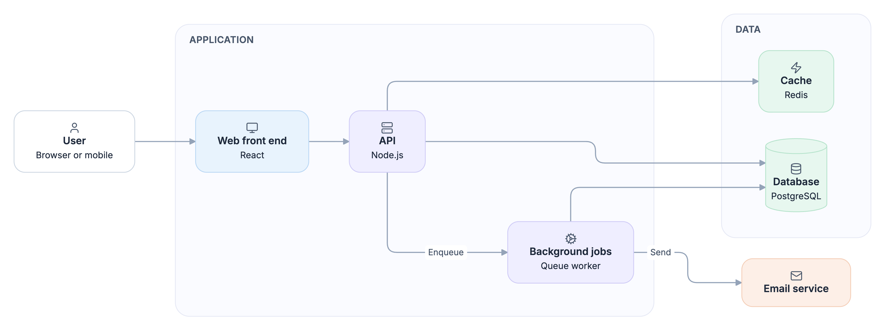 | 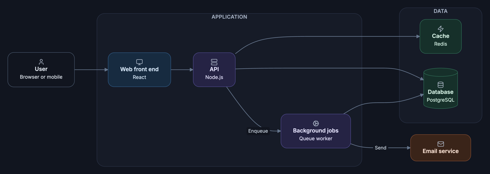 |
| 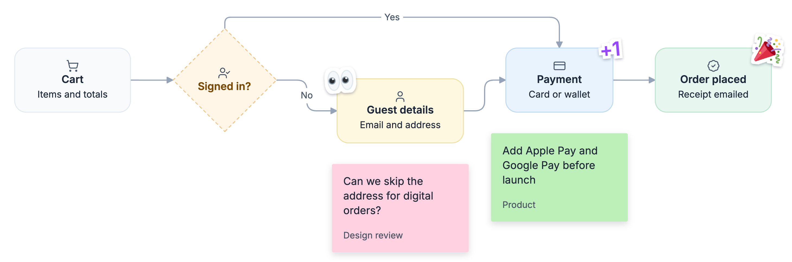 | 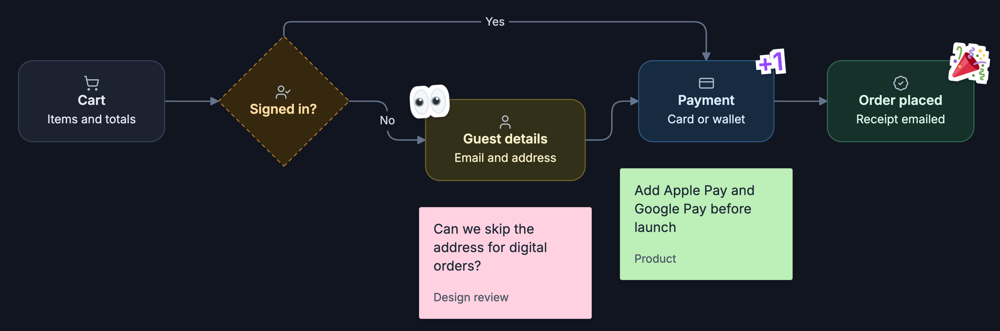 |
| 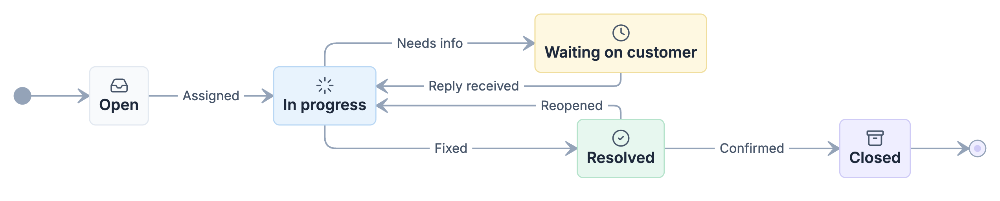 | 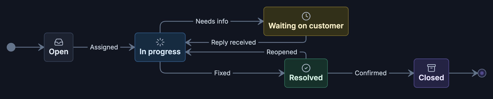 |
|  | 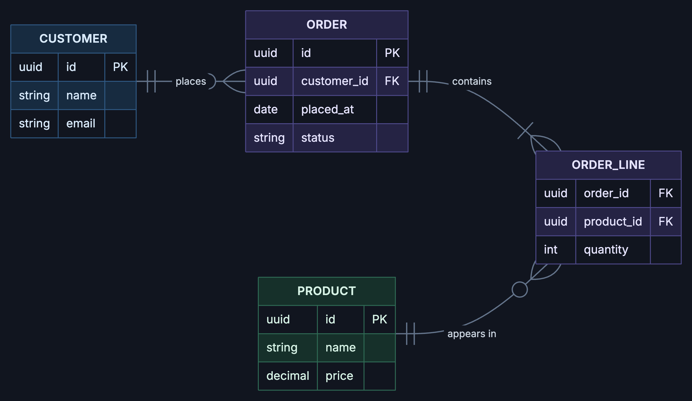 |
|  | 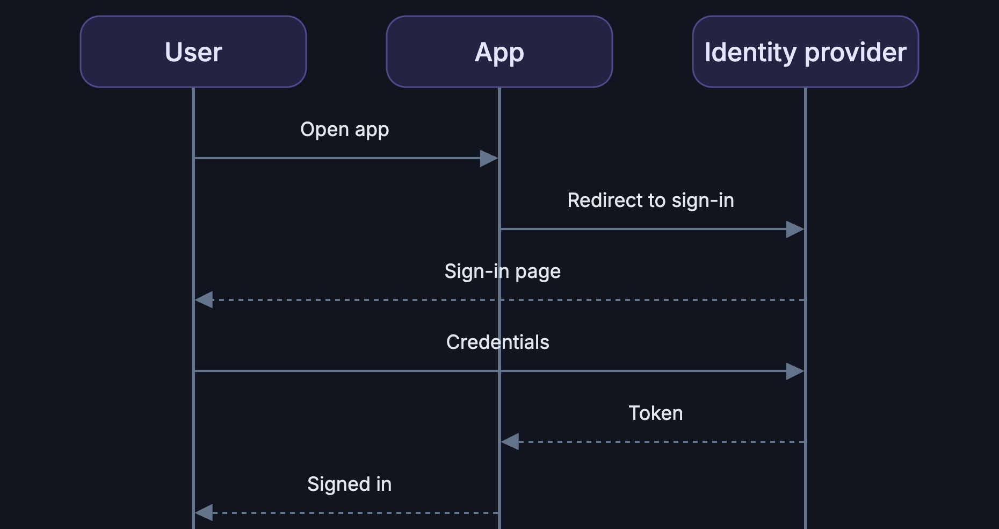 |
| 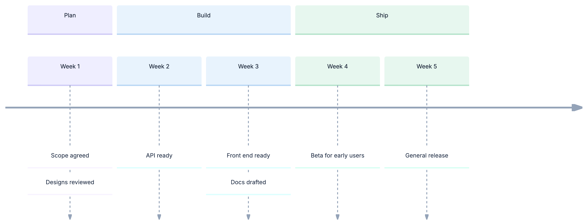 |  |
| 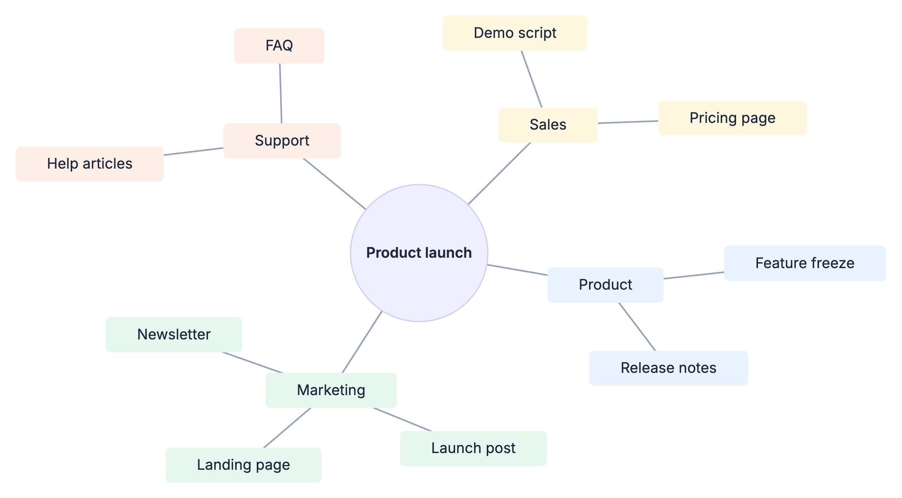 |  |

Sources: [architecture](examples/architecture.mmd) (flowchart with groups), [checkout-review](examples/checkout-review.mmd) (sticky notes and stickers), [ticket-states](examples/ticket-states.mmd) (state diagram), [shop-data-model](examples/shop-data-model.mmd) (ER diagram), [login-sequence](examples/login-sequence.mmd) (sequence), [release-timeline](examples/release-timeline.mmd) (timeline), [launch-mindmap](examples/launch-mindmap.mmd) (mindmap), [order-lifecycle](examples/order-lifecycle.mmd) (flowchart with a decision).

## Writing diagrams

Diagrams are standard [Mermaid](https://mermaid.js.org). The renderer adds the style, so the source stays short. Supported types: flowcharts, state diagrams, sequence diagrams, ER diagrams, timelines and mindmaps.

| Write | Result |
|---|---|
| `i:database` | Any [Lucide icon](https://lucide.dev/icons) in a flowchart or state label |
| `<b>Title</b><br/><span class='s'>Subtitle</span>` | Bold title with a grey subtitle |
| `:::grey` `:::sky` `:::lav` `:::mint` `:::yellow` `:::peach` | Card colours (flowchart nodes, ER entities) |
| `class Open mint` | Card colour for a state |
| `:::decision` | Dashed amber decision (use with `{"..."}`) |
| `:::ext` | White card for external systems |
| `subgraph id["Name"] ... end` | Tinted group panel with its caption in the top-left corner |
| `%% title: My diagram` | Title of the HTML page and the SVG `<title>` |

Colour suggestions: grey = start/neutral, sky = in progress, lav = services, mint = done/data, yellow = waiting, peach = error.

**Connectors.** In flowcharts and state diagrams, [libavoid](https://www.adaptagrams.org/documentation/libavoid.html) re-routes every connector with straight segments around the other cards. Connectors attach to the centre of a card side. When several share a side they spread evenly along it (two at 1/3 and 2/3, three at 1/4, 1/2 and 3/4, and so on), ordered so they do not cross. Diamonds and circles use one line per tip. Edge labels sit on the longest free stretch of their line. `--edges curved` gives Mermaid's curves instead.

**Layout check.** After each diagram the renderer reports crossing edges, edges running through cards, overlapping labels and clipped labels, so an agent can fix a diagram without looking at it:

```
ok   architecture  ->  docs/diagrams/architecture.{svg,png,html,auto.svg}
     check WARN 7 nodes, 7 edges, 1 crossings, 0 overlaps, 0 clipped
       - edge "API Node.js → Cache Redis" crosses edge "Background jobs Queue worker → Email service"
```

More than 12 nodes gives a warning to split the diagram. `--check` turns problems into a non-zero exit code for scripts and CI.

## Sticky notes and stickers

Add review comments and reactions to flowcharts and state diagrams with comment lines. Mermaid ignores comments, so the same file still renders anywhere else.

```
%% note guest: Can we skip the address for digital orders? | Design review | pink
%% note pay: Add Apple Pay and Google Pay before launch | Product | green
%% sticker done: 🎉
%% sticker pay: +1
%% sticker guest: 👀 | top-left
```


| Line | Options |
|---|---|
| `%% note <node id>: text \| author \| colour` | Sticky note in the nearest free space next to the card. Author and colour are optional. Colours: `yellow` (default), `green`, `pink`, `blue`, `purple`, `orange`. |
| `%% sticker <node id>: text or emoji \| corner \| colour` | Die-cut sticker pinned to a card corner: `top-right` (default), `top-left`, `bottom-right`, `bottom-left`. Text sticker colours: `purple` (default), `green`, `pink`, `blue`, `orange`, `red`, `yellow`. |

Any of the ~3,700 emoji in [Twemoji](https://github.com/jdecked/twemoji) works as a sticker, and they look the same on every system. Notes and stickers are drawn into the image; viewers cannot add their own.

## Themes

`--theme <name>` picks the palette, font, corner radius and connector colours; `--dark` picks its dark variant. Every text colour in every theme meets WCAG AA contrast (`npm run check-themes`).

| Theme | Light | Dark |
|---|---|---|
| `pastel` (default) | 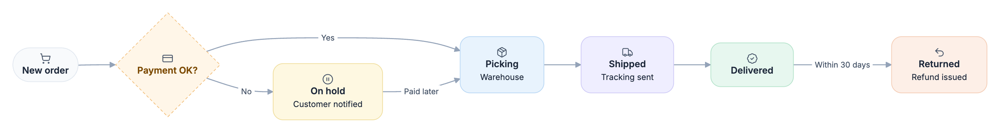 | 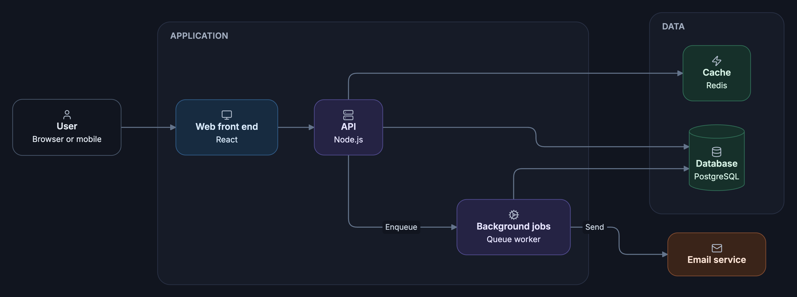 |
| `mono` |  | 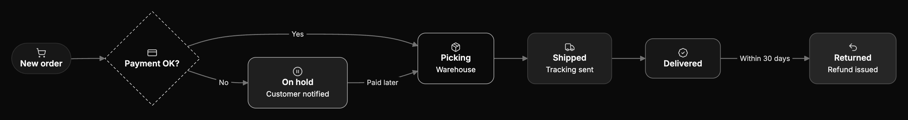 |
| `corporate` |  | 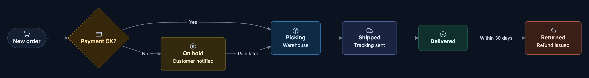 |
| `high-contrast` | 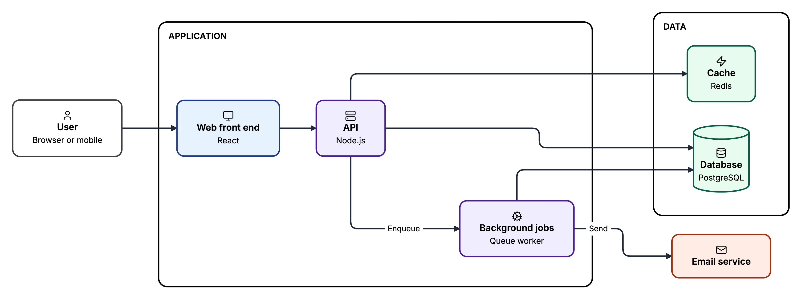 |  |

Themes are JSON files in [`themes/`](themes). For your own, copy `themes/pastel.json` and `themes/pastel-dark.json` to `my-theme.json` and `my-theme-dark.json`, edit the colours, and pass `--theme path/to/my-theme.json`.

## Command line

From a clone, run `node scripts/render.mjs`; without one, `npx --yes github:mustafa-patharia/pastel-diagrams` takes the same arguments.

```bash
node scripts/render.mjs path/to/diagram.mmd                    # .svg/.png/.html/.auto.svg next to it
node scripts/render.mjs docs/diagrams/src --out docs/diagrams  # a whole folder
node scripts/render.mjs flow.mmd --theme corporate --dark      # another theme, dark variant
node scripts/render.mjs flow.mmd --formats png,auto --scale 2  # only some outputs, 2x PNG
node scripts/render.mjs docs/guide.md                          # ```mermaid blocks in Markdown
node scripts/render.mjs docs --md --out build/docs             # every .md in a folder
```

| Option | Effect |
|---|---|
| `--out <folder>` | Output folder (default: next to each input) |
| `--theme <name\|file.json>` | `pastel`, `mono`, `corporate`, `high-contrast`, or your own theme file |
| `--dark` | Dark variant of the theme |
| `--edges orthogonal\|curved` | Straight connectors between side centres (default), or Mermaid's curves |
| `--formats <list>` | Any of `svg,png,html,auto` (default: all) |
| `--scale <n>` | PNG resolution (default 3) |
| `--check` | Exit with code 2 when the layout check finds problems |
| `--json` | Print the layout reports as JSON |
| `--md` | In folders, render `.md` files instead of `.mmd` files |
| `--md-image png\|svg\|auto` | Image the rendered Markdown links to (default `png`) |

If no browser is found, set `CHROME_PATH` to the browser executable.

**Light and dark that follows GitHub's own theme setting:** instead of the `.auto.svg` (which follows the viewer's system), use a `<picture>` with both renders:

```html
<picture>
  <source media="(prefers-color-scheme: dark)" srcset="docs/diagrams/dark/flow.svg">
  
</picture>
```

## How it works

[Mermaid](https://mermaid.js.org) lays out the diagram in headless Chrome through [puppeteer-core](https://pptr.dev), using a theme from `themes/`. The script then re-routes flowchart and state connectors with [libavoid-js](https://github.com/Aksem/libavoid-js), places sticky notes and stickers, embeds [Inter](https://rsms.me/inter/), [Lucide](https://lucide.dev) icons and [Twemoji](https://github.com/jdecked/twemoji) as data URIs (so the SVG and HTML work offline), rounds the corners, adds an accessible `<title>` and `<desc>`, measures the layout for the check, and exports the files.

## Like it?

- ⭐ [Star the repo](https://github.com/mustafa-patharia/pastel-diagrams) so more people find it.
- Found a bug or want a feature? [Open an issue](https://github.com/mustafa-patharia/pastel-diagrams/issues).
- Made something nice with it? Share it in an issue; it may become an example here.

## License

MIT © Mustafa Patharia.

Third-party parts keep their own licences: libavoid-js is LGPL-2.1-or-later and is installed as a separate npm package; emoji graphics are [Twemoji](https://github.com/jdecked/twemoji) by Twitter, Inc. and other contributors, licensed under [CC-BY 4.0](https://creativecommons.org/licenses/by/4.0/); Lucide icons are ISC; the Inter font is under the SIL Open Font License.
