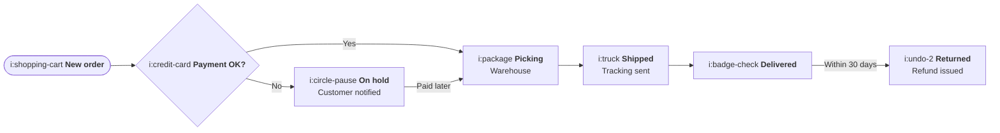
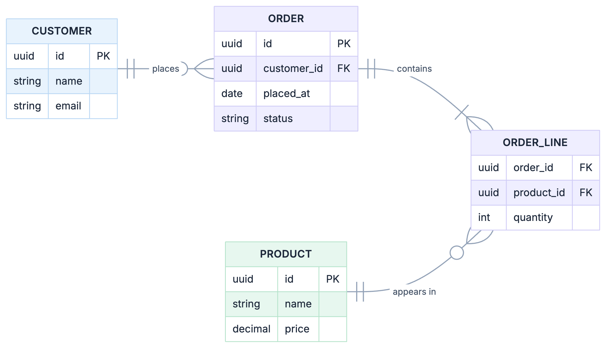
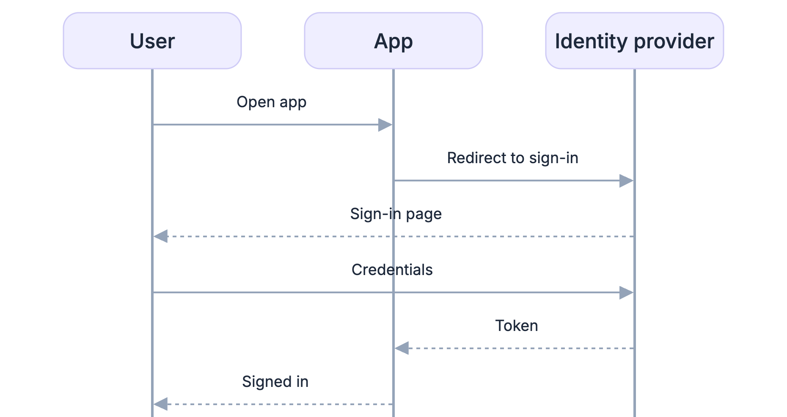
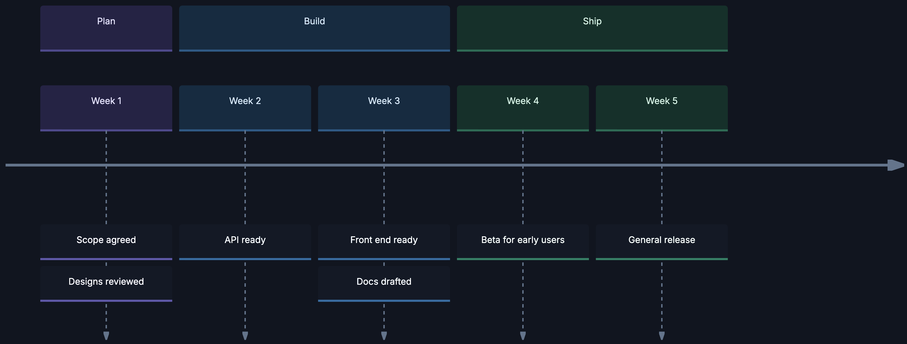
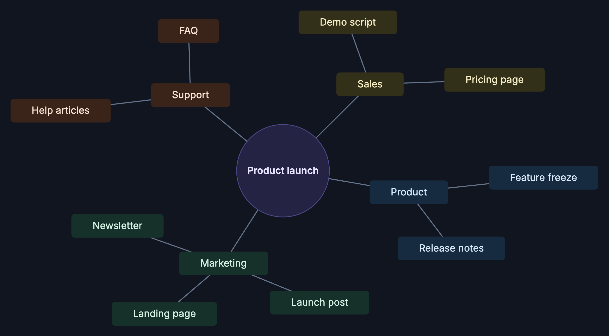
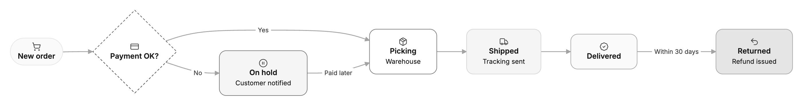
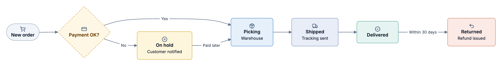
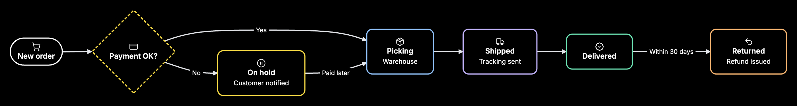

# pastel-diagrams

An AI agent skill (Claude Code and other agents that read `SKILL.md`) and a command-line tool that turns plain Mermaid into clean, modern diagrams: soft pastel cards, the Inter font, Lucide icons and thin curved connectors, in light or dark. Every diagram is exported as an **SVG**, a **3x PNG**, a **self-contained HTML** page and an **SVG that follows light/dark mode**, ready for docs, READMEs, Word guides and slides.

You write this:



and get this (it switches to the dark version when your system is in dark mode):



## Examples

| Light | Dark |
|---|---|
|  |  |
|  |  |
|  |  |
|  |  |
|  |  |
|  |  |

Sources: [architecture](examples/architecture.mmd) (flowchart with groups), [ticket-states](examples/ticket-states.mmd) (state diagram), [shop-data-model](examples/shop-data-model.mmd) (ER diagram), [login-sequence](examples/login-sequence.mmd) (sequence), [release-timeline](examples/release-timeline.mmd) (timeline), [launch-mindmap](examples/launch-mindmap.mmd) (mindmap), [order-lifecycle](examples/order-lifecycle.mmd) (flowchart with a decision). Each has an `.svg`, `.html` and `.auto.svg` next to it.

## Themes

`--theme <name>` picks the palette, font, corner radius and connector colours; `--dark` picks its dark variant. Every text colour in every theme meets WCAG AA contrast (`npm run check-themes`).

| Theme | Light | Dark |
|---|---|---|
| `pastel` (default) |  |  |
| `mono` |  |  |
| `corporate` |  |  |
| `high-contrast` |  |  |

Themes are JSON files in [`themes/`](themes). For your own, copy `themes/pastel.json` and `themes/pastel-dark.json` to `my-theme.json` and `my-theme-dark.json`, edit the colours, and pass `--theme path/to/my-theme.json`.

## Install

Requirements: Node.js 18+ and an installed Chrome, Edge or Chromium (nothing extra is downloaded).

**As a Claude Code skill (all projects):**

```bash
git clone https://github.com/mustafa-patharia/pastel-diagrams ~/.claude/skills/pastel-diagrams
cd ~/.claude/skills/pastel-diagrams && npm install
```

For one project only, clone into `<project>/.claude/skills/pastel-diagrams` instead. Then ask the agent for a diagram ("draw the checkout flow as a diagram"); it reads `SKILL.md` and follows the workflow, including the layout check below.

**Other agents:** point the agent at `SKILL.md`, or use the command line.

**Command line, without cloning:**

```bash
npx --yes github:mustafa-patharia/pastel-diagrams docs/diagrams
```

## Command line

```bash
node scripts/render.mjs path/to/diagram.mmd                    # .svg/.png/.html/.auto.svg next to it
node scripts/render.mjs docs/diagrams/src --out docs/diagrams  # a whole folder
node scripts/render.mjs flow.mmd --theme corporate --dark      # another theme, dark variant
node scripts/render.mjs flow.mmd --formats png,auto --scale 2  # only some outputs, 2x PNG
node scripts/render.mjs docs/guide.md                          # ```mermaid blocks in Markdown
node scripts/render.mjs docs --md --out build/docs             # every .md in a folder
```

| Option | Effect |
|---|---|
| `--out <folder>` | Output folder (default: next to each input) |
| `--theme <name\|file.json>` | `pastel`, `mono`, `corporate`, `high-contrast`, or your own theme file |
| `--dark` | Dark variant of the theme |
| `--formats <list>` | Any of `svg,png,html,auto` (default: all) |
| `--scale <n>` | PNG resolution (default 3) |
| `--check` | Exit with code 2 when the layout check finds problems |
| `--json` | Print the layout reports as JSON |
| `--md` | In folders, render `.md` files instead of `.mmd` files |
| `--md-image png\|svg\|auto` | Image the rendered Markdown links to (default `png`) |

If no browser is found, set `CHROME_PATH` to the browser executable.

### Layout check

After each diagram the renderer reports the node count, crossing edges, edges running through other nodes, overlapping labels and clipped labels, so an agent can fix a diagram and render again without looking at the image:

```
ok   architecture  ->  docs/diagrams/architecture.{svg,png,html,auto.svg}
     check WARN 7 nodes, 7 edges, 1 crossings, 0 overlaps, 0 clipped
       - edge "API Node.js → Cache Redis" crosses edge "Background jobs Queue worker → Email service"
```

More than 12 nodes gives a warning to split the diagram. `--check` turns problems into a non-zero exit code for scripts and CI.

### Markdown files

Each ```` ```mermaid ```` block is rendered to `diagrams/<file>-<n>.{svg,png}`, and a copy of the Markdown is written with the blocks swapped for image links (`guide.rendered.md` next to the source, or `<out>/guide.md` with `--out`). The source file is not changed.

### GitHub Action

[`examples/github-action/render-diagrams.yml`](examples/github-action/render-diagrams.yml) renders every `.mmd` file in a repository on push and commits the images. Copy it to `.github/workflows/` in your repository.

### Light and dark in a GitHub README

Link the `.auto.svg`; it shows the dark render when the viewer's system is in dark mode. To follow GitHub's own theme setting instead, use a `<picture>` with both renders:

```html
<picture>
  <source media="(prefers-color-scheme: dark)" srcset="docs/diagrams/dark/flow.svg">
  
</picture>
```

## Cheat sheet

| Write | Result |
|---|---|
| `i:database` | Any [Lucide icon](https://lucide.dev/icons) in a flowchart or state label |
| `<b>Title</b><br/><span class='s'>Subtitle</span>` | Bold title with a grey subtitle |
| `:::grey` `:::sky` `:::lav` `:::mint` `:::yellow` `:::peach` | Card colours (flowchart nodes, ER entities) |
| `class Open mint` | Card colour for a state |
| `:::decision` | Dashed amber decision (use with `{"..."}`) |
| `:::ext` | White card for external systems |
| `subgraph id["Name"] ... end` | Tinted group panel with an uppercase caption |
| `%% title: My diagram` | Title of the HTML page and the SVG `<title>` |

Colour suggestions: grey = start/neutral, sky = in progress, lav = services, mint = done/data, yellow = waiting, peach = error.

## How it works

[Mermaid](https://mermaid.js.org) lays out the diagram. The script runs it in headless Chrome through [puppeteer-core](https://pptr.dev) with a theme from `themes/`, embeds [Inter](https://rsms.me/inter/) and [Lucide](https://lucide.dev) icons as data URIs (so the SVG and HTML work offline), rounds the corners, adds an accessible `<title>` and `<desc>`, measures the layout in the browser for the check, and exports the files.

## License

MIT © Mustafa Patharia
